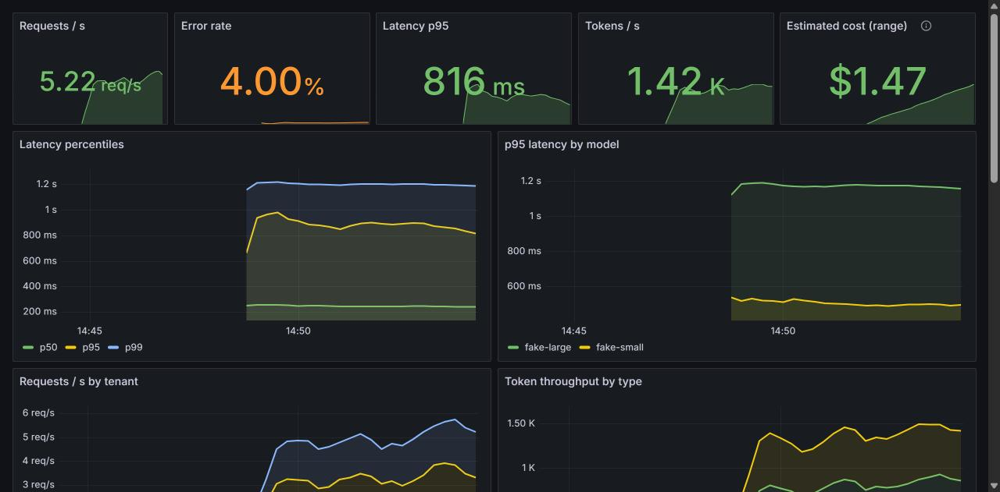
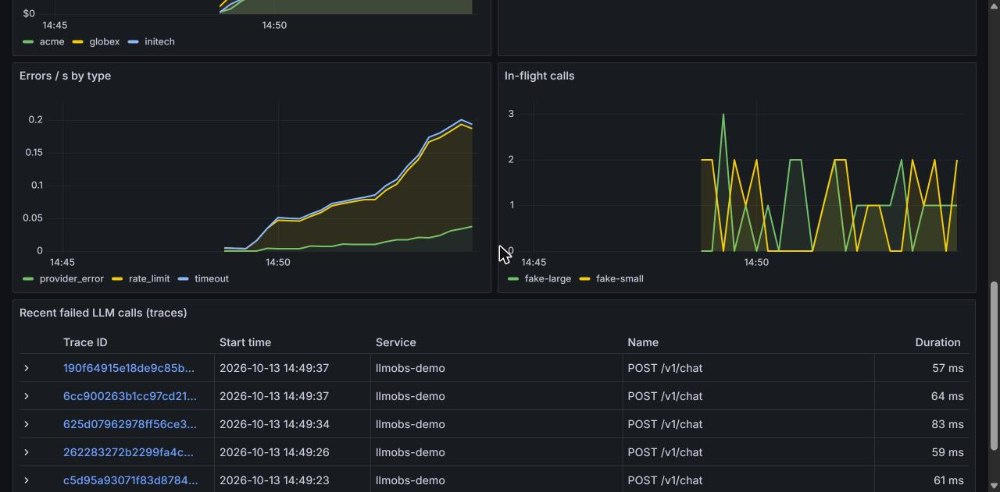
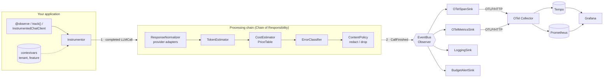

# llmobs: OpenTelemetry observability for LLM calls

[](https://github.com/choukamani/llm-observability/actions/workflows/ci.yml)


> **Demonstration project.** An original, generic implementation of LLM-observability patterns, written for my portfolio. It is not a production system and contains no code or data from any employer.

A small, typed Python library that makes every LLM call observable (**latency, tokens, estimated cost, errors, per tenant and per feature**) through standard OpenTelemetry, plus a one-command Grafana stack to see it.



## Problem

LLM calls are the slowest, most expensive and least predictable dependency of a GenAI application, yet in most codebases they are invisible: no latency percentiles, no token counts, no idea which tenant or feature burns the budget, and provider errors (rate limits, timeouts) that only appear as generic 500s.

Vendor tracing SDKs solve part of this but create a second telemetry silo. `llmobs` emits **plain OpenTelemetry using the GenAI semantic conventions**, so LLM spans nest under your HTTP spans and land in whatever backend you already run (Grafana, Google Cloud Monitoring, Datadog...).

## What you get

- **One decorator, context manager or client wrapper** per call site; sync and async.
- **Spans** following the GenAI conventions (`gen_ai.provider.name`, `gen_ai.request.model`, `gen_ai.usage.*`, `error.type`), timestamped with the real call boundaries.
- **Metrics:** `gen_ai.client.operation.duration`, `gen_ai.client.token.usage` (recommended buckets), estimated cost, errors by type, in-flight calls.
- **Request-scoped attributes** (`tenant`, `feature`...) via `contextvars`, safe across `await` and concurrent tasks.
- **Provider adapters** for OpenAI / Azure OpenAI (Chat Completions and Responses), Mistral and Ollama. They are duck-typed, so no provider SDK is imported.
- **Token estimation** when a provider reports no usage, flagged `llm.usage.estimated=true`.
- **Cost estimation** from a dated, versioned price table, and **budget alerts** per tenant.
- **Privacy by default:** prompts and completions are *not* exported. When opted in, they are redacted (emails, card numbers, phones) and truncated.
- **Fail-safe:** a bug in a processor or exporter is logged, never raised into your application.

<details>
<summary>Errors by type, in-flight calls and failed-call traces (Tempo)</summary>



</details>

## Quick start (3 commands)

```bash
git clone https://github.com/choukamani/llm-observability && cd llm-observability
cp .env.example .env          # optional: change ports
make up                       # or: make up ENGINE=podman
```

Open Grafana at <http://localhost:3000>. The *LLM Observability* dashboard fills within a minute, fed by a traffic generator calling a simulated LLM with a 5 % failure rate. **No API key is needed.**

Library-only usage:

```python
import llmobs
from openai import OpenAI

obs = llmobs.Instrumentor.create()  # uses your global OpenTelemetry providers
client = OpenAI()


@obs.observe("openai", "gpt-4o-mini", prompt_arg="question")
def ask(question: str):
    return client.chat.completions.create(
        model="gpt-4o-mini", messages=[{"role": "user", "content": question}]
    )


with llmobs.attributes(tenant="acme", feature="support-bot"):
    ask("Where is my order?")
```

## Architecture



Two separate concerns, two patterns: **enrichment** (each step needs the previous one's output, order matters) is a chain, while **export** (independent destinations) is publish/subscribe. See [ADR 3](docs/adr/0003-chain-of-responsibility-for-enrichment.md).

## Design patterns used

| Pattern | Where | Why |
|---|---|---|
| Decorator (function) | [`Instrumentor.observe`](src/llmobs/instrumentor.py) | Instrument a call site without touching its body; sync and async. |
| Decorator (object) | [`InstrumentedChatClient`](src/llmobs/clients.py) | Same interface as the wrapped client, observability added transparently. |
| Chain of Responsibility | [`pipeline/base.py`](src/llmobs/pipeline/base.py), [`pipeline/processors.py`](src/llmobs/pipeline/processors.py) | Each handler decides if it applies, then forwards; add or reorder steps without editing others. |
| Observer | [`events.py`](src/llmobs/events.py), [`sinks/`](src/llmobs/sinks/) | Decouple the event source from N exporters; a failing sink is isolated. |
| Adapter | [`providers/adapters.py`](src/llmobs/providers/adapters.py) | Normalise OpenAI, Mistral and Ollama responses into one `TokenUsage` model. |
| Strategy | adapter selection in [`ResponseNormalizer`](src/llmobs/pipeline/processors.py) | Pick the normalisation algorithm per provider at runtime, with a generic fallback. |
| Factory method | [`Instrumentor.create`](src/llmobs/instrumentor.py), [`default_chain`](src/llmobs/instrumentor.py) | One place assembles the default chain and sinks; tests inject their own. |
| Facade | [`Instrumentor`](src/llmobs/instrumentor.py) | A three-method API hides chain, bus and OpenTelemetry. |

## Measured results

All numbers below come from scripts in this repository. Re-run them with `make bench` and `make test`.

**Instrumentation overhead per call** ([`benchmarks/overhead.py`](benchmarks/overhead.py), 20 000 calls after 2 000 warm-up; the instrumented function does no work, so this is pure instrumentation cost):

| Scenario | Linux container, p50 | Linux container, p95 | Windows 11 host, p50 | Windows 11 host, p95 |
|---|---:|---:|---:|---:|
| No instrumentation | 0.11 µs | 0.19 µs | 0.3 µs | 0.5 µs |
| llmobs chain only (no exporters) | 18 µs | 52 µs | 42 µs | 95 µs |
| llmobs + OpenTelemetry SDK (span + 6 metric records) | 215 µs | 620 µs | 600 µs | 1 049 µs |

Environment: Python 3.12, Intel laptop CPU (Family 6 Model 186). The Linux run is `python:3.12-slim` under Podman/WSL2. Raw JSON is in [`benchmarks/results/`](benchmarks/results/).

**How to read this:** the cost is dominated by the OpenTelemetry Python SDK (attribute validation and metric aggregation), not by `llmobs`. At about 0.2–0.6 ms, it represents well under 1 % of a typical hosted-LLM call, which takes hundreds of milliseconds to seconds. It would matter for very high-frequency local inference, where the chain can run without the SDK metrics. Variance is high on a laptop (p99 values are in the JSON files).

**Tests:** 67 tests (unit + end-to-end through FastAPI → OTel SDK), **97.8 % branch coverage**, `mypy --strict` clean.

## Technical choices and trade-offs

| Choice | Rationale | Trade-off |
|---|---|---|
| OpenTelemetry + GenAI conventions ([ADR 2](docs/adr/0002-opentelemetry-genai-semantic-conventions.md)) | Portable, joins existing traces, no new vendor | Conventions are still "development" status and may rename attributes |
| Span emitted at call *end* with explicit timestamps | No mutable span state shared across the bus; exact duration | Child spans created *inside* the LLM call (e.g. HTTP client spans) are not nested under it |
| Content dropped by default ([ADR 4](docs/adr/0004-content-not-captured-by-default.md)) | Telemetry backends are a classic personal-data leak | Debugging a bad answer needs content capture explicitly enabled |
| Local cost estimation ([ADR 5](docs/adr/0005-estimated-cost-from-a-price-table.md)) | Providers return no price; teams need cost per tenant now | Drifts with price changes; no cached-token or batch discounts |
| Duck-typed provider adapters | Zero dependency on provider SDKs, works with raw JSON | A provider changing its response shape is detected only by tests |
| Prometheus + Tempo behind the collector | Open-source, one `docker compose`; same OTLP works with Cloud Monitoring | Local storage only, demo-grade retention |

## Known limitations

- Streaming responses are measured as a whole: no time-to-first-token metric yet.
- Token estimation is a characters-per-token heuristic, not a real tokenizer.
- Budget totals live in process memory; they reset on restart and are per instance.
- Regex redaction does not catch names, addresses or free-form identifiers.
- `tenant` and `feature` become metric labels: keep their cardinality bounded.
- The bundled price table is a dated snapshot (see `as_of` in [`pricing.toml`](src/llmobs/pricing.toml)), not a billing source.

## Roadmap

- Time-to-first-token and tokens/second for streaming calls.
- Optional `tiktoken` / provider tokenizers behind the `TokenEstimator` interface.
- Exemplars linking latency histogram buckets to traces.
- Shared budget state (Redis) for multi-instance deployments.
- Evaluation hooks (answer quality scores as span events).

## Project layout

```
src/llmobs/
├── instrumentor.py     # Facade + decorator + default chain factory
├── model.py            # LLMCall, TokenUsage, error taxonomy
├── context.py          # request-scoped attributes (contextvars)
├── pipeline/           # Chain of Responsibility: base + built-in processors
├── providers/          # response adapters (OpenAI, Mistral, Ollama, generic)
├── events.py           # EventBus (Observer)
├── sinks/              # OpenTelemetry spans/metrics, logging, budget alerts
├── pricing.py/.toml    # versioned price table
├── clients.py          # ChatClient protocol, instrumented wrapper, fake LLM
└── otel.py             # optional OTLP/HTTP setup helper
examples/demo_app/      # FastAPI demo + traffic generator
deploy/                 # collector, Prometheus, Tempo, Grafana provisioning + dashboard
benchmarks/             # overhead benchmark + raw results
docs/adr/               # architecture decision records
```

## Development

```bash
make install     # uv sync + pre-commit hooks
make check       # ruff + mypy --strict + pytest (coverage gate 80 %)
make bench       # overhead benchmark
```

CI ([`.github/workflows/ci.yml`](.github/workflows/ci.yml)) runs lint, strict typing and tests, then builds the image, starts the stack and checks that metrics actually reach Prometheus.

---

## Résumé en français

**llmobs** est une bibliothèque Python typée qui rend observables les appels aux LLM via OpenTelemetry, selon les conventions sémantiques GenAI. Elle mesure la latence, les tokens, le coût estimé et les erreurs classées, par client (tenant) et par fonctionnalité. Une stack Grafana (collecteur OTel, Prometheus, Tempo) se lance en une commande, sans clé API, grâce à un LLM simulé.

- **Architecture :**
  - une chaîne de responsabilité enrichit chaque appel (normalisation par fournisseur, estimation des tokens, coût, classification des erreurs, politique de contenu) ;
  - un bus d'événements (Observer) diffuse les appels vers des exporteurs indépendants ;
  - des décorateurs instrumentent le code sans le modifier.
- **Choix structurants :**
  - les prompts ne sont pas exportés par défaut (RGPD) ;
  - le coût est estimé à partir d'une grille de prix datée ;
  - une erreur d'instrumentation ne casse jamais l'application.
- **Résultats mesurés :**
  - surcoût d'environ 0,2 à 0,6 ms par appel (médiane), essentiellement dû au SDK OpenTelemetry, soit moins de 1 % d'un appel LLM hébergé ;
  - 67 tests et 97,8 % de couverture.
- **Projet de démonstration :** réimplémentation originale et générique, sans code ni donnée d'un employeur.

## License

[MIT](LICENSE) © 2026 Amani Chouk
